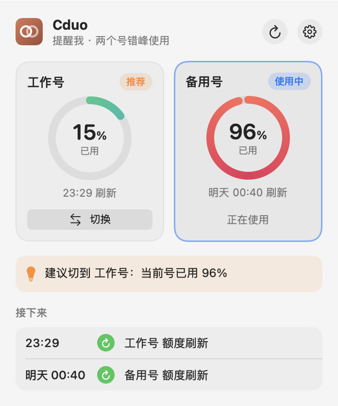
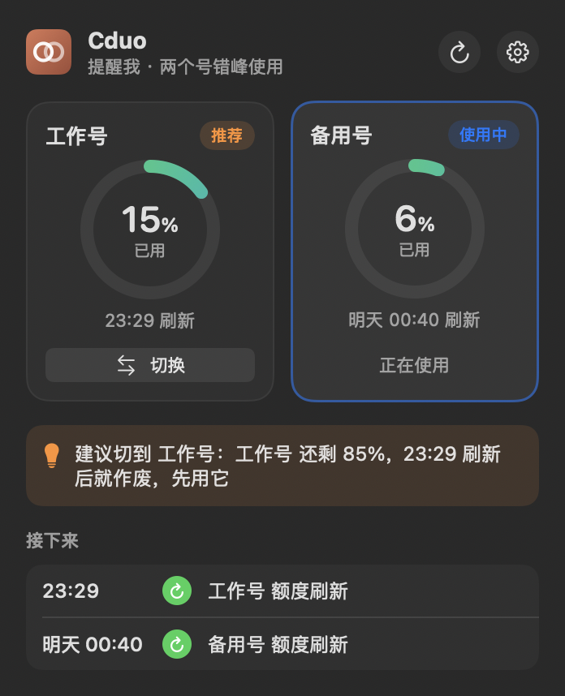

# Cduo：两个 Claude 号轮着用，额度不浪费

Cduo 是一个菜单栏小工具，适合有两个 Claude 账号、主要用 **Claude 桌面版**的人。

- **一键换号，对话不丢。** 点一下，Claude 会自动重启成另一个号（约 10 秒）。重启后点开原来的会话，就能接着聊。
- **额度错峰刷新。** Claude 的额度每 5 小时刷新一次。Cduo 会让两个号错开 2.5 小时开始计时，这样每隔 2.5 小时就有一个号刷新，很少会两个号同时用完。
- **用完自动换号，任务自动续上。** 设成「全自动」后，当前号用完就自动换到另一个号；如果有任务正跑到一半被额度打断，换号后 Cduo 会替你发一句「继续」。两个号都用完时，等先刷新的那个，到点自动接着跑。

<p align="center">
  
  
</p>

## 适合谁

- 用 Mac（macOS 13 或更新），主要在 **Claude 桌面版**里聊天、写代码；
- 有**两个 Claude 账号**，额度主要卡在「5 小时」限额上。

## 安装

**1. 先装苹果的命令行工具**（装过可跳过，用于编译菜单栏小程序）。打开「终端」App，运行：

```bash
xcode-select --install
```

**2. 下载并安装 Cduo：**

```bash
git clone https://github.com/cccignore/cduo.git ~/cduo && bash ~/cduo/install.sh
```

装好后，屏幕右上角会出现 Cduo 的图标。第一次用：点它 →「开始设置」，在弹出的终端窗口里按提示操作：
1. 填你一般几点开始用、几点收工。
2. 两个号各在浏览器里授权一次。
3. 在 Claude 里登录第 2 个号。

全部大约 5 分钟。**过程中 Claude 会重启几次，期间不要点 Claude 里的「退出登录」。**

第一次换号时，macOS 会询问两件事，都选「允许」：
- 是否允许 Cduo 发通知；
- 是否允许控制 Claude。

如果要用「自动续上被打断的任务」，还要在「系统设置 → 隐私与安全性 → 辅助功能」里打开 Cduo（设置页有「去授权」按钮）。Cduo 只用这个权限做一件事：打开被打断的会话，粘贴一句续上的话，按回车。**每次升级 Cduo 后，可能需要重新打开一次这个开关。**

**以后升级：**

```bash
cd ~/cduo && git pull && bash install.sh
```

## 菜单栏怎么看

菜单栏上是**两个小圆环**加一个百分比：
- 每个圆环代表一个号，圆弧越长表示用得越多，中间有实心点的是 Claude 桌面版正在用的号；
- 百分比是当前这个号在本轮 5 小时里已经用掉的额度；
- 后面出现橙色小点，说明 Cduo 建议你换号。

**点一下打开面板：**
- 两个号**并排两张卡片**：圆环仪表、刷新时间、「切换」按钮。被推荐的号会标「推荐」，按钮变成橙色。
- **建议条**：为什么该换、两个号都用完时几点恢复。
- **接下来**：最近几次额度刷新或开始计时的时间。
- 右上角 ⟳ 刷新额度，⚙︎ 打开设置。

**设置页：**
- **切换方式**：
  - 手动：只显示额度；
  - 提醒我：该换号时发通知，点「切换」即可（可以设「用到多少算快用完」：80 / 90 / 95%）；
  - 全自动：用完才换号，一点不浪费；
- **自动续上被打断的任务**（默认开）；
- 切换前确认；
- **自动提前计时**的开关，以及开始用、收工的时间；
- **固定组织**：如果你的号属于多个组织（比如学校的 Premium Seat 和另一个组织），换号后总是进入同一个；
- 账号显示名（直接改，回车保存）、让某个号立刻开始计时；
- 开机启动、同步会话、自检、设置向导、日志、退出。

也可以在 Claude 的对话里直接说「切号」或「看下额度」。

## 规则（想了解原理再看）

- **自动提前计时**：两个号都没在计时，就让当前在用的号先开始。前一个号已经计时 2.5 小时，就让另一个号开始。之后哪个号一刷新，就在合适的时间再让它开始。每次只发一条极小的消息（约 3k token），只在你设定的时段内进行。
- **该用哪个号**：先用快刷新的那个，因为没有周限额，没用完的额度到点就作废了。
- **什么时候换**：
  - 全自动：当前号**用完**才换（不在 95% 时提前换，剩下的额度也不浪费）。另一个号还剩很多、又快刷新时，只在你离开超过 1 小时后才顺手换过去（那时缓存反正过期了，换号不多花额度）。
  - 提醒我：到了你设的阈值就发通知；另一个号还剩 25% 以上、而且 90 分钟内就要刷新，也会建议先去用掉它。
- **什么时候自动续上**：只有任务**正在跑、被额度打断**时才续上，也就是会话的最后一条记录就是「额度用完」的报错，之后你没再发过消息。你自己停掉的、空闲的、正常换号的会话都不会动。续上时 Cduo 等你一段时间没碰键盘鼠标，再打开那个会话发一句话；没能发出去，就发一条通知，点开后粘贴发送即可。
- **两个号都用完**：记住被打断的任务。哪个号先刷新，就在刷新后自动换过去（或留在原号）并续上。
- **刷新时间**以官方接口返回的为准。窗口开始时间会往下取整，比如 18:33 开始，23:30 就刷新。

## 命令行（可选）

```bash
cduo                       # 看额度
cduo switch [名字]          # 换号
cduo config auto_switch off|notify|idle   # idle = 全自动
cduo config auto_resume on|off             # 被额度打断的任务是否自动续上
cduo resume test           # 测试自动续上：往你最新建的会话里发一句无害的测试消息
cduo config work_hours 10:00-01:00
cduo rename neu1 学校号
cduo doctor                # 自检
```

## 注意

- **不要用 Claude 里的「退出登录」来换号**，换号一律用 Cduo。
- 换号后第一条消息会多耗一点额度，因为缓存要重建。对话很长时，可以先 `/compact` 再换。
- 换号要重启 Claude（约 10 秒），所有会话都会暂停一下。
- 某个号桌面版很久不用，登录可能过期。到时菜单里会提示，点一下重新登录就行。
- 定时任务、已发布的 Artifact、连接器，仍然只属于创建它们的那个号。
- Cduo 依赖 Claude 桌面版没有公开的文件结构，Claude 大版本更新后可能失效。每次换号前都会备份到 `~/.cduo/backup/`。
- 两个号都要是你自己的。按规则轮换使用多个号属于灰色地带，请你自己判断。
- Cduo 是个人做的小工具，和 Anthropic 没有关系，也不是官方产品。只在本机读写文件，只连 Anthropic 自己的接口（查额度、刷新登录、发预热消息），不会把数据发到别处。

## 常见问题

- **提示「过程中要重启 Claude，不能在 Claude 里面运行」**：你是在 Claude 自己的终端面板或对话里运行的 `cduo setup`。设置时要重启 Claude，会把它自己也关掉，所以 Cduo 会自动在 macOS 的「终端」App 里打开设置向导，切到那个窗口继续就行。
- **终端里提示 `command not found: cduo`**：新开一个终端窗口再试（安装时已把 `~/.local/bin` 加进 PATH）；或者直接点菜单栏 Cduo →「开始设置」。

## 卸载

```bash
cduo agents uninstall
rm -rf /Applications/Cduo.app ~/.cduo ~/.local/bin/cduo ~/.claude/skills/cduo ~/cduo
```

## 许可

MIT
