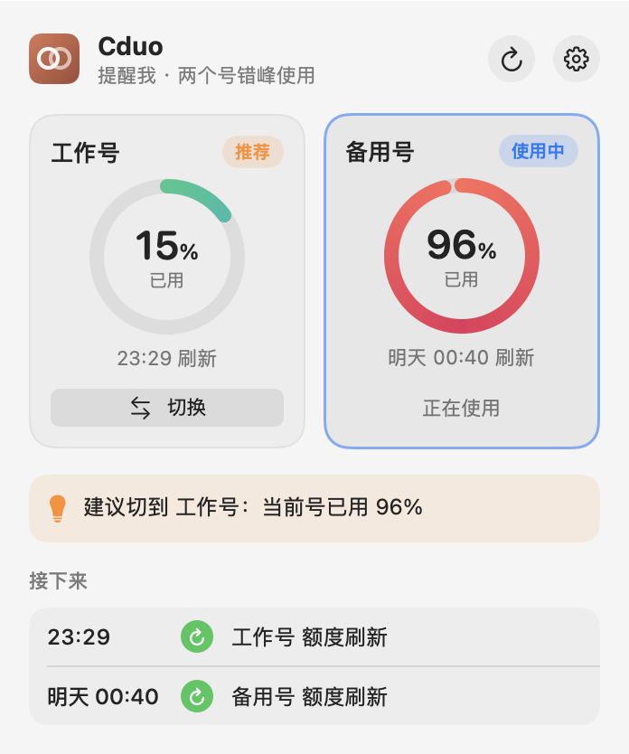
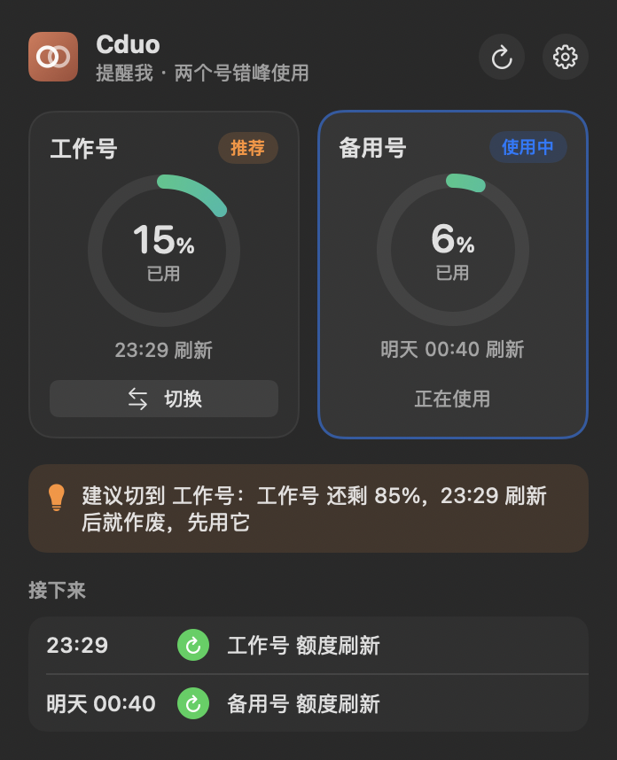

# Cduo：多个 Claude 号轮着用，额度不浪费

Cduo 是一个菜单栏小工具，适合有两个或更多 Claude 账号、主要用 **Claude 桌面版**的人。

- **一键换号，对话不丢。** 点一下，Claude 会自动重启成另一个号（约 10 秒）。重启后点开原来的会话，就能接着聊。
- **额度错峰刷新。** Claude 的额度每 5 小时刷新一次。Cduo 会让各个号错开开始计时：两个号错开 2.5 小时，三个号错开 1 小时 40 分，以此类推。这样隔一段时间就有一个号刷新，很少会所有号同时用完。
- **用完自动换号，任务自动续上。** 设成「全自动」后，当前号用完就自动换到还有额度、最先刷新的那个号；如果有任务正跑到一半被额度打断，换号后 Cduo 会替你发一句「继续」。所有号都用完时，等先刷新的那个，到点自动接着跑。

<p align="center">
  
  
</p>

## 适合谁

- 用 Mac（macOS 13 或更新），主要在 **Claude 桌面版**里聊天、写代码；
- 有**两个或更多 Claude 账号**，额度主要卡在「5 小时」限额上。

## 安装

**1. 先装苹果的命令行工具**（装过可跳过，用于编译菜单栏小程序）。打开「终端」App，运行：

```bash
xcode-select --install
```

**2. 下载并安装 Cduo：**

```bash
git clone https://github.com/cccignore/cduo.git ~/cduo && bash ~/cduo/install.sh
```

装好后，屏幕右上角会出现 Cduo 的图标。第一次用：点它 →「开始设置」，在弹出的终端窗口里按提示操作：
1. 填你一般几点开始用、几点收工。
2. 每个号各在浏览器里授权一次（先加两个，之后向导会问你还要不要再加）。
3. 在 Claude 里把其余几个号各登录一次。

每个号大约两三分钟。**过程中 Claude 会重启几次，期间不要点 Claude 里的「退出登录」。**

以后想再加一个号：菜单栏 ⚙︎ →「账号」→「添加账号」，或者运行 `cduo setup --add`。不再用某个号：在「账号」里点那个号后面的 ⋯ →「移除…」。确认时可以勾选「同时清除它在本机的登录和备份」，借来的号用完建议勾上（命令行：`cduo remove 名字 --purge`）。

第一次换号时，macOS 会询问两件事，都选「允许」：
- 是否允许 Cduo 发通知；
- 是否允许控制 Claude。

如果要用「自动续上被打断的任务」，还要在「系统设置 → 隐私与安全性 → 辅助功能」里打开 Cduo（设置页有「去授权」按钮）。Cduo 只用这个权限做一件事：打开被打断的会话，粘贴一句续上的话，按回车。

**以后升级：**

```bash
cd ~/cduo && git pull && bash install.sh
```

升级时，只要菜单栏程序本身没变（大部分升级只改命令行核心），安装脚本就不会动 `Cduo.app`，辅助功能授权一直有效。菜单栏程序有更新时，安装脚本会提示你把这个开关关掉再打开一次。

**升级后不用重新授权（可选）：** macOS 的授权认的是 App 的签名。默认用的是临时签名，App 一变授权就失效。想以后都不用重新授权，可以建一个本机自用的代码签名证书：打开「钥匙串访问」→ 菜单「钥匙串访问 → 证书助理 → 创建证书…」，名称填 `Cduo Local`，身份类型选「自签名根证书」，证书类型选「代码签名」。然后运行：

```bash
echo 'Cduo Local' > ~/.cduo/sign-identity && bash ~/cduo/install.sh
```

之后重新授权最后一次，以后升级就都不用了。

## 菜单栏怎么看

菜单栏上是**每个号一个小圆环**（号多时最多画 5 个，正在用的号一定在里面）加一个百分比：
- 每个圆环代表一个号，圆弧越长表示用得越多，中间有实心点的是 Claude 桌面版正在用的号；
- 百分比是当前这个号在本轮 5 小时里已经用掉的额度；按现在的速度 1 小时内就会用完时，后面还会显示预计用完的时间（比如「62% · 15:20」）；
- 后面出现橙色小点，说明需要你动手：快用完了、任务被打断了、或者有号要登录。「另一个号快到期，可以先用」这种提示不亮橙点。

**点一下打开面板：**
- 每个号**一张卡片，两张一行**：圆环仪表、刷新时间、「切换」按钮。超过 4 个号时卡片区域可以上下滚动，正在用的号排在最前面。
  - 需要你换过去的号标「推荐」、按钮变橙色；只是「快到期，可以先用」的号标灰色的「可先用」。
  - 卡片上的小字：按现在的速度几点用完、本周已用多少（接口有周额度数据时）、预热失败的原因和再试时间、「不参与预热」。
  - 读不到额度时说清楚原因：网络/代理连不上、请求被拒、接口限流、登录失效。圆环会变淡，显示上次读到的数和「X 分钟前的数据」。只有登录真失效了才给「重新登录」，其他情况给「重试」。
  - 代理偶尔掐断一次连接很常见：读额度的请求会自己重试两次；还是没读到、且只是偶尔一次的，照常显示上次读到的数，连续两次读不到才标出来。登录失效第一次就标。
- **建议条**：为什么该换、所有号都用完时几点恢复、代理/网络从几点起连不上（连续两轮都连不上才算）、自动续上缺授权。
- **接下来**：最近几次额度刷新或开始计时的时间。
- 右上角 ⟳ 刷新额度，⚙︎ 打开设置。

**设置页：**
- **切换方式**：
  - 只显示：只显示额度，不发通知；
  - 快用完提醒（默认）：快用完、或按现在的速度会在刷新前用完时发通知，通知上直接点「切换」（可以设「用到多少算快用完」：80 / 90 / 95%）。同一件事每个 5 小时窗口只提醒一次；
    - 「提醒我先用快到期的额度」：另一个号快刷新、额度还剩很多时，发一条不响铃、不弹横幅的提醒。默认关，只在面板里显示；
  - 自动换号：用完才换号，一点不浪费；
- **自动续上被打断的任务**（默认开）；
- 切换前确认；
- **自动提前计时**的开关，以及开始用、收工的时间；
- **固定组织**：如果你的号属于多个组织（比如学校的 Premium Seat 和另一个组织），换号后总是进入同一个；
- 账号显示名（直接改，回车保存）、让某个号立刻开始计时、添加账号；每个号后面的 ⋯：参与自动预热（关掉后照样显示额度、能换过去，适合也在别处用的号）、重新登录、移除；
- 开机启动、同步会话、自检、设置向导、日志、退出。

也可以在 Claude 的对话里直接说「切号」或「看下额度」。

## 规则（想了解原理再看）

- **自动提前计时**：所有号都没在计时，就让当前在用的号先开始。最近开始的那个号已经计时「5 小时 ÷ 号数」（两个号就是 2.5 小时），就让下一个空闲的号开始。之后哪个号一刷新，就在合适的时间再让它开始。每次只发一条极小的消息（约 3k token），只在你设定的时段内进行。
  - 只给这一轮额度读取成功的号发（说明网络、代理、登录此刻都正常）；排在前面的号发不了，就轮到下一个，不会卡住。
  - 因为网络/代理失败的，10 分钟后再试；其他原因失败的，1 小时后再试；登录失效的号先不发，等重新登录。
  - 所有号都连不上时暂停，恢复后自动继续；电脑唤醒 30 秒后会先补查一轮。
  - 周额度已经用到 80% 的号不再预热。
- **该用哪个号**：在还有额度的号里，先用快刷新的那个：5 小时额度没用完，到点也就作废了。付费套餐还有**周额度**（每周固定时间刷新），所以周额度紧张的号排在后面，周额度用完的号不会被换过去。不带名字的 `cduo switch` 也按这个规则挑。
- **什么时候换**：
  - 全自动：当前号**用完**才换（不在 95% 时提前换，剩下的额度也不浪费）。换之前会等 Claude 这一轮回复结束，并等你 30 秒没碰键盘鼠标，免得在你打字时把 App 重启掉。另一个号还剩很多、又快刷新时，只在桌面版的会话 1 小时没动静、而且你 10 分钟没碰电脑时才顺手换过去（那时缓存反正过期了，换号不多花额度）。
  - 判断「Claude 还在忙」只看桌面版自己的会话（含子任务），终端里一直在跑的 `claude` 不会挡住换号。
  - 快用完提醒：到了你设的阈值、或者按最近一小时的速度会在刷新前用完，就发通知。另一个号还剩 25% 以上、90 分钟内就要刷新（而且周额度不紧张）时，面板上会提示可以先用它；只有当前号已经用到 60% 以上、预计会用完，或者打开了「提醒我先用快到期的额度」，才发一条不打扰的通知。
- **什么时候自动续上**：只有任务**正在跑、被额度打断**时才续上，也就是会话的最后一条记录就是「额度用完」的报错，之后你没再发过消息。你自己停掉的、空闲的、正常换号的会话都不会动。续上时 Cduo 等你一段时间没碰键盘鼠标，再打开那个会话发一句话。如果窗口标题显示打开的不是这个会话，就不发。发出后会去会话记录里核对：没对上就**不再自动重试**（免得重复发、发错地方），改为发一条通知，点开后粘贴发送即可；如果发现这句话进了别的会话，通知里会告诉你是哪个。
- **所有号都用完**：记住被打断的任务。哪个号先刷新，就在刷新后自动换过去（或留在原号）并续上。
- **刷新时间**以官方接口返回的为准。窗口开始时间会往下取整，比如 18:33 开始，23:30 就刷新。

## 命令行（可选）

```bash
cduo                       # 看额度
cduo switch [名字]          # 换号（不带名字：换到还有额度、最先刷新的号）
cduo setup --add           # 再加一个号
cduo remove 名字            # 不再管理某个号（保留它的登录，以后加回来不用重新授权）
cduo remove 名字 --purge    # 同时清除它在本机的登录和备份（借来的号用完用这个）
cduo prewarm 名字 off       # 这个号不参与自动预热（照样显示额度、能换过去）
cduo login 名字             # 重新给某个号授权查额度（在无痕窗口里打开授权页）
cduo config auto_switch off|notify|idle   # 只显示 / 快用完提醒 / 自动换号
cduo config notify_expiring on|off         # 另一个号快到期时，也发一条不打扰的提醒
cduo config auto_resume on|off             # 被额度打断的任务是否自动续上
cduo resume test           # 测试自动续上：往你最新建的会话里发一句无害的测试消息
cduo config work_hours 10:00-01:00
cduo rename neu1 学校号
cduo doctor                # 自检（含 Claude 版本、文件结构检查、备份数量）
cduo agents status         # 后台调度有没有在跑
cduo restore               # 列出桌面版登录备份
cduo restore latest        # 恢复到最近一次换号前的登录
```

## 注意

- **不要用 Claude 里的「退出登录」来换号**，换号一律用 Cduo。
- 换号后第一条消息会多耗一点额度，因为缓存要重建。对话很长时，可以先 `/compact` 再换。
- 换号要重启 Claude（约 10 秒），所有会话都会暂停一下。
- 某个号桌面版很久不用，登录可能过期。到时菜单里会提示，点一下重新登录就行。
- 定时任务、已发布的 Artifact、连接器，仍然只属于创建它们的那个号。
- Cduo 依赖 Claude 桌面版没有公开的文件结构，Claude 大版本更新后可能失效。为此：
  - 每次换号前先检查文件结构，不认识就不换号，一个文件都不动（`cduo doctor` 能看到原因）；
  - 每次换号前都会备份到 `~/.cduo/backup/`。换号写到一半出错会自动恢复；万一换完要求重新登录，运行 `cduo restore latest` 回到换号前；
  - Claude 更新后第一次换号，通知里会提醒你有这个恢复办法。
- 这些号都要是你自己的。按规则轮换使用多个号属于灰色地带，号越多越是如此，请你自己判断。
- Cduo 是个人做的小工具，和 Anthropic 没有关系，也不是官方产品。只在本机读写文件，只连 Anthropic 自己的接口（查额度、刷新登录、发预热消息），不会把数据发到别处。

## 常见问题

- **提示「过程中要重启 Claude，不能在 Claude 里面运行」**：你是在 Claude 自己的终端面板或对话里运行的 `cduo setup`。设置时要重启 Claude，会把它自己也关掉，所以 Cduo 会自动在 macOS 的「终端」App 里打开设置向导，切到那个窗口继续就行。
- **登录某个号，结果登成了另一个号**：几个号属于同一个组织、走同一个单点登录（SSO）时容易出现。授权页在默认浏览器里打开，浏览器里还登录着另一个号，SSO 就直接按那个号放行了。
  - 额度一栏显示「未登录」：运行 `cduo login 名字`。授权页会在无痕窗口里打开并预填这个号的邮箱，不受浏览器里已登录账号的影响；登成别的号会自动撤销，原来的登录不变。默认浏览器是 Safari 时，会改用装了的 Chrome、Edge、Brave 或 Firefox，也可以用 `cduo config login_browser /Applications/某浏览器.app` 指定。
  - 桌面版的登录由 Claude 自己用默认浏览器打开，没法强制无痕。`cduo login-desktop 名字` 会提前提醒，可以临时把默认浏览器换成没登录过这些号的浏览器，登录保存后再换回来。换号时 Cduo 会把桌面版的最新登录存回快照，所以这一步一般只在第一次设置时做。
- **某个号一直显示「满额 · 未开始计时」**：预热由后台调度每 5 分钟做一次，菜单栏刷新只读额度。运行 `cduo agents status`，tick 显示「未安装」就是后台调度没在跑（比如手动暂停后没恢复、换机迁移后还没重新登录）。菜单栏刷新时会自动把它重新加载上，也可以手动运行 `cduo agents install`。想停掉预热请用 `cduo config prewarm_enabled off`。
- **终端里提示 `command not found: cduo`**：新开一个终端窗口再试（安装时已把 `~/.local/bin` 加进 PATH）；或者直接点菜单栏 Cduo →「开始设置」。

## 卸载

```bash
cduo agents uninstall
rm -rf /Applications/Cduo.app ~/.cduo ~/.local/bin/cduo ~/.claude/skills/cduo ~/cduo
```

## 许可

MIT
